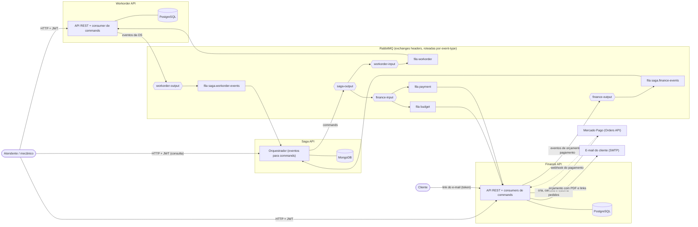
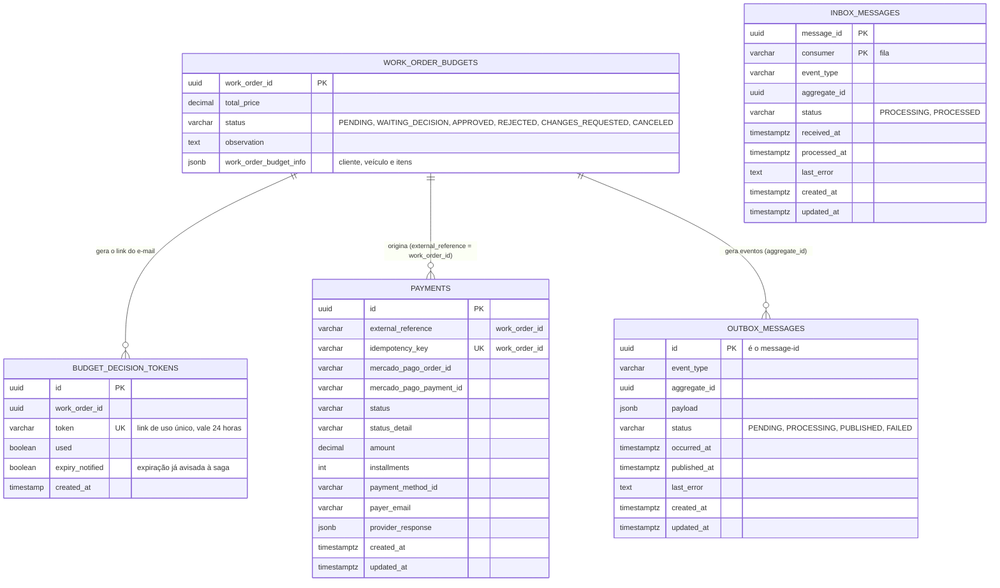
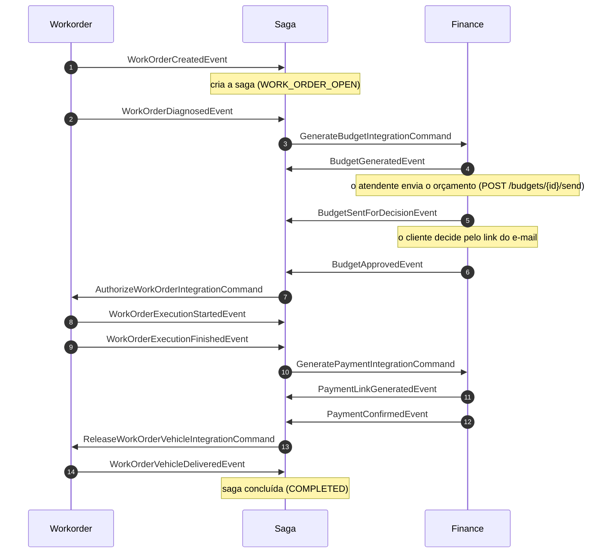
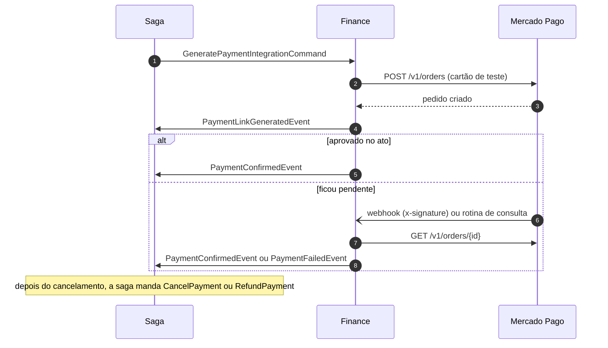
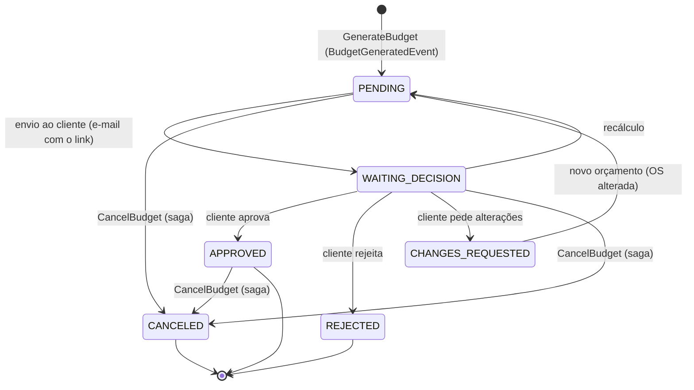

# Mecânica DM - Finance API (Orçamento e Pagamento)

[](https://sonarcloud.io/project/overview?id=mecanica-dm_mecanicadm-finance-api-v4)


API de **Orçamento e Pagamento** (Billing Service) do sistema **Mecânica DM**. Gera o orçamento da OS, envia ao cliente por e-mail, registra a decisão (aprovar, rejeitar ou pedir alterações) e integra com o **Mercado Pago** para gerar, cancelar e estornar o pagamento e acompanhar o seu resultado. Participa da saga executando os commands que ela manda e publicando os eventos do que aconteceu.

Na **Fase 04** do 15SOAT, a aplicação foi refatorada para **microsserviços independentes** (Workorder, Finance e Saga), cada um com repositório, banco e pipeline próprios, que se integram por mensageria e mantêm a consistência das transações críticas com o **Saga Pattern**. Esta API **não chama os outros serviços por HTTP**: toda a integração é por mensageria (RabbitMQ), e o banco é só dela.

---

## 📚 Documentação Externa e Modelagem

- **[Storytelling (Egon.io)](https://github.com/user-attachments/assets/fd2adfad-1fa9-469d-958a-1cf902666b36)**: Storytelling inicial do fluxo de funcionamento da mecânica.
- **[Dicionário de Dados (Notion)](https://lopsided-hourglass-4f8.notion.site/Dicion-rio-de-dados-32f0a8ca8e738075ae44c9ec0b5180b3?source=copy_link)**: Visão detalhada das entidades e relacionamentos do banco de dados (modelagem da Fase 03).
- **[Event Storming (Miro)](https://miro.com/app/board/uXjVIT7cD_4=/?share_link_id=217316260154)**: Mapeamento de domínio e comportamento orientado a eventos do sistema.
- **[Dashboard do SonarCloud](https://sonarcloud.io/project/overview?id=mecanica-dm_mecanicadm-finance-api-v4)**: Análise contínua de qualidade de código, vulnerabilidades e cobertura de testes.

### Arquitetura geral do sistema

Três microsserviços, cada um com o seu banco, falando só por mensageria. A saga hospeda o broker e conduz o fluxo.

<div align="center">



</div>

### Fluxo de CI/CD

```mermaid
flowchart LR
    TRIGGER[Disparo do Workflow] --> COND{Evento}
    COND -->|push em main| M1[Branch: main]
    COND -->|pull_request| PR[Pipeline PR]
    COND -->|workflow_dispatch| WD[Manual]

    M1 --> BUILD
    PR --> BUILD
    WD --> BUILD

    subgraph BUILD[build-and-test]
        direction LR
        A1[Checkout]
        A2[Setup JDK 21]
        A3[mvn clean verify]
        A4[Análise Sonar]
        A1 --> A2 --> A3 --> A4
    end

    subgraph SEC[security-scan]
        direction LR
        S1[Checkout]
        S2[Subir aplicação]
        S3[ZAP Scan OpenAPI]
        S4[Upload Relatório]
        S5[Parar containers]
        S1 --> S2 --> S3 --> S4 --> S5
    end

    BUILD -->|sucesso| SEC

    subgraph PUB[publish-and-deploy]
        direction LR
        P1[Login Docker Hub]
        P2[Build e push imagem]
        P3[Disparar deploy K8s]
        P1 --> P2 --> P3
    end

    SEC -->|sucesso| GATE{Em main?}
    GATE -->|sim| PUB
    GATE -->|não| FIM1[Fim - sem deploy]
    PUB --> FIM2[Deploy no K8s]
```

<div align="center">



</div>

* build-and-test: Responsável por fazer o maven build, executar os testes unitários e de integração (`mvn clean verify`) e a análise do Sonar.
* security-scan: Rodamos o ZAP Scan para verificar problemas de segurança.
* publish-and-deploy: Aqui fazemos o build da imagem docker e publicamos para o Docker Hub, além disso fazemos um trigger para rodar a próxima pipe do repositório de k8s.

### Diagrama de Entidade-Relacionamento



### Diagramas de sequência

#### Caminho feliz de uma OS



#### Pagamento (com webhook do Mercado Pago)



#### Ciclo de vida do orçamento



---

## ✨ Funcionalidades Principais

- **💰 Geração e Controle de Orçamentos**: Criação do orçamento a partir dos dados da OS (cliente, veículo, mão de obra e materiais), com recálculo, ajuste manual e controle do status de aprovação.
- **🖨️ Impressão de Orçamento**: Geração do orçamento em PDF, retornado pela API como string Base64.
- **📧 Envio e Decisão pelo Cliente**: O orçamento vai por e-mail, com PDF e links; o cliente aprova, rejeita ou pede alterações por um **link público de uso único e válido por 24 horas**, sem precisar de conta.
- **⌛ Expiração**: Quando o link vence sem resposta, uma rotina avisa a saga uma única vez, e ela cancela a OS.
- **💳 Pagamento com Mercado Pago**: Gera o pedido (API de Orders) a partir do orçamento, cancela o pedido ainda não pago e estorna o pagamento confirmado, tudo de forma idempotente.
- **🔔 Webhook e Verificação**: O resultado do pagamento chega pelo **webhook do Mercado Pago** (protegido por assinatura) e por uma rotina de consulta que reconcilia.
- **🎼 Participação na Saga**: Executa os commands (gerar e cancelar orçamento; gerar, cancelar e estornar pagamento) e publica os eventos; quando um command falha por regra de negócio, avisa a saga com o `FinanceCommandRejectedEvent`.
- **🔐 Autenticação e Autorização**: Segurança baseada em JWT (emitido pela Workorder).
- **🌐 Suporte a Múltiplos Idiomas**: Mensagens de erro e validação em Português, Inglês e Espanhol.

---

## 🚀 Tecnologias Utilizadas

| Categoria        | Tecnologia                                                          |
|------------------|---------------------------------------------------------------------|
| **Core**         | Java 21, Spring Boot 3.4                                            |
| **Dados**        | Spring Data JPA, PostgreSQL, Flyway (Migrations)                    |
| **Mensageria**   | RabbitMQ (Spring AMQP), padrão Outbox/Inbox                         |
| **Pagamento**    | Mercado Pago (API de Orders), webhook com assinatura                |
| **Documentos**   | Thymeleaf + Flying Saucer (PDF do orçamento), Spring Mail           |
| **Segurança**    | Spring Security, JWT (Java JWT)                                     |
| **Documentação** | Springdoc (Swagger/OpenAPI 3)                                       |
| **Testes**       | JUnit 5, Mockito, Testcontainers (PostgreSQL), MockRestServiceServer |
| **Qualidade**    | JaCoCo, SonarCloud                                                  |
| **Build**        | Maven                                                               |
| **Container**    | Docker, Docker Compose, Mailpit (e-mails de teste)                  |

---

## 🏛️ Arquitetura e Decisões

O projeto segue uma arquitetura limpa, inspirada em princípios de _Clean Architecture_, para garantir separação de responsabilidades, testabilidade e manutenibilidade. As decisões são registradas em **Architecture Decision Records (ADRs)** e **RFCs**.

Arquitetura limpa, separada por funcionalidade: o `core` não depende de framework, e a `infra` é a borda técnica.

```
src/main/java/com/mecanicadm/mecanicadm_finance_api
├── core/
│   ├── workorder/             orçamento: domínio, casos de uso, eventos e commands
│   ├── payment/               pagamento: domínio, casos de uso (criar, cancelar, estornar) e eventos
│   └── shared/                recusa de commands, inbox e publicação de eventos (portas)
├── infra/features/<feature>/
│   ├── api/                   controllers REST e DTOs
│   ├── messaging/             listeners das filas `budget` e `payment`
│   └── persistence/           JPA e gateways (inclusive o do Mercado Pago)
├── infra/messaging/           outbox, inbox e RabbitMQ
├── infra/{security,pdf,email,config,handler}/
└── shared/                    exceções e contratos comuns
```

### 📝 ADRs (`docs/adr/`):

- **[ADR 001 - Nomenclatura das consultas](docs/adr/001-nomenclatura_consultas.md)**
- **[ADR 002 - Exchange do tipo headers](docs/adr/002-headers-exchange.md)**
- **[ADR 003 - Estratégia de inbox](docs/adr/003-estrategia-inbox.md)**
- **[ADR 004 - Evento de recusa de command 🆕](docs/adr/004-evento-de-recusa-de-command.md)**
- **[ADR 005 - Pagamento: gerar, cancelar e estornar de forma idempotente 🆕](docs/adr/005-pagamento-cancelar-e-estornar-de-forma-idempotente.md)**
- **[ADR 006 - Rota pública de decisão do orçamento 🆕](docs/adr/006-rota-publica-de-decisao-do-orcamento.md)**
- **[ADR 007 - Webhook do Mercado Pago 🆕](docs/adr/007-webhook-do-mercado-pago.md)**

### 📝 RFCs (`docs/rfc/`):

- **[RFC 001 - Expiração do orçamento 🆕](docs/rfc/001-expiracao-do-orcamento.md)**
- **[RFC 002 - Verificação do pagamento 🆕](docs/rfc/002-verificacao-de-pagamento.md)**

---

## 💰 Ciclo de vida do orçamento

| Status | Como chega | Como sai |
|---|---|---|
| `PENDING` | O command `GenerateBudget` cria o orçamento (`BudgetGeneratedEvent`), ou `recalculate` o recalcula (`BudgetUpdatedEvent`) | Envio ao cliente |
| `WAITING_DECISION` | `POST /budgets/{id}/send` envia o e-mail com o PDF e os links (`BudgetSentForDecisionEvent`; se o envio falhar, `BudgetSentForDecisionFailedEvent`) | Decisão do cliente, ou a expiração (veja abaixo) |
| `APPROVED` | Decisão do cliente pelo link, ou manual (`/decision`): `BudgetApprovedEvent` | (final) |
| `REJECTED` | Decisão de rejeição, com o motivo: `BudgetRejectedEvent` | (final) |
| `CHANGES_REQUESTED` | Decisão de pedido de alterações: `BudgetChangesRequestedEvent` | Novo orçamento, depois que a OS é alterada |
| `CANCELED` | Command `CancelBudget` da saga: `BudgetCanceledEvent` (idempotente) | (final) |

**O link do e-mail** abre a decisão sem JWT, tem **uso único** e vale **24 horas** ([ADR 006](docs/adr/006-rota-publica-de-decisao-do-orcamento.md)).

**Expiração:** se o cliente não decidir em 24 horas, uma rotina publica o `BudgetExpiredEvent` **uma única vez** (marca o token como avisado). O Finance não cancela o orçamento sozinho: a saga cancela a OS e manda o `CancelBudget`, e o orçamento vai a `CANCELED` ([RFC 001](docs/rfc/001-expiracao-do-orcamento.md)).

---

## 💳 Pagamento

O pagamento é gerado a partir do orçamento da OS (total, descrição e dados do cliente) e usa o `workOrderId` como chave de idempotência, então há no máximo um pedido por OS. Gerar, cancelar e estornar são **idempotentes**: repetir o command é seguro, e as chamadas ao Mercado Pago levam a sua própria `X-Idempotency-Key` ([ADR 005](docs/adr/005-pagamento-cancelar-e-estornar-de-forma-idempotente.md)).

| Command | Efeito | Evento |
|---|---|---|
| `GeneratePaymentIntegrationCommand` | Cria o pedido no Mercado Pago | `PaymentLinkGeneratedEvent`, e `PaymentConfirmedEvent` ou `PaymentFailedEvent` se o resultado já vier no ato; `PaymentLinkGenerationFailedEvent` se falhar |
| `CancelPaymentIntegrationCommand` | Cancela o pedido ainda não pago (sem pagamento, só confirma; pagamento já confirmado é recusado) | `PaymentCanceledEvent` |
| `RefundPaymentIntegrationCommand` | Estorna o pagamento confirmado (sem pagamento ou não confirmado, recusa) | `PaymentRefundedEvent` |

**Verificação do pagamento:** o resultado do pedido nem sempre vem no ato da criação. Ele chega por dois caminhos que se complementam ([RFC 002](docs/rfc/002-verificacao-de-pagamento.md)):

- **Webhook do Mercado Pago** (resposta em segundos): `POST /v1/payments/webhooks/mercado-pago`, rota pública protegida pela assinatura (`x-signature`). O Finance usa só o `data.id`, consulta o pedido no Mercado Pago (`GET /v1/orders/{id}`) e, se o resultado mudou, atualiza o registro e publica `PaymentConfirmedEvent` ou `PaymentFailedEvent` uma única vez ([ADR 007](docs/adr/007-webhook-do-mercado-pago.md)).
- **Rotina de consulta** (reconciliação): a cada minuto consulta os pagamentos ainda em estado não final, para o caso de uma notificação se perder ou o webhook não estar configurado.

Pagamentos em estado final (confirmado, recusado, cancelado ou estornado) não são consultados de novo.

**Para ligar o webhook:** (1) exponha a API em uma URL pública HTTPS (em desenvolvimento, um túnel como o ngrok: `ngrok http 8082`); (2) no painel do Mercado Pago, em *Suas integrações, Webhooks*, informe `https://<url-publica>/api/v1/payments/webhooks/mercado-pago` e marque o evento **Order (Mercado Pago)**; (3) copie a **assinatura secreta** gerada para `MERCADO_PAGO_WEBHOOK_SECRET` e reinicie a API. Sem o segredo, o endpoint responde 503 e nada é processado (só a rotina de consulta funciona).

---

## 📬 Mensageria

A API troca mensagens com a saga pelo padrão **Outbox/Inbox**: o evento é gravado no banco na mesma transação da mudança, e um relay o publica no RabbitMQ; cada command recebido é registrado no inbox pelo header `message-id`, para não ser executado duas vezes ([ADR 003](docs/adr/003-estrategia-inbox.md)). As exchanges são do tipo `headers`, roteadas pelo header `event-type`, que é o nome da classe ([ADR 002](docs/adr/002-headers-exchange.md)).

**Consome** (enviados pela saga pela exchange `finance-input`):

| Fila | Command | Efeito |
|---|---|---|
| `budget` | `GenerateBudgetIntegrationCommand` (`workOrderId`, `workOrderSnapshot`) | Gera o orçamento com os dados da OS |
| `budget` | `CancelBudgetIntegrationCommand` | Cancela o orçamento |
| `payment` | `GeneratePaymentIntegrationCommand` (`workOrderId`) | Gera o pedido de pagamento |
| `payment` | `CancelPaymentIntegrationCommand` | Cancela o pedido ainda não pago |
| `payment` | `RefundPaymentIntegrationCommand` | Estorna o pagamento confirmado |

**Publica** (exchange `finance-output`):

| Origem | Eventos |
|---|---|
| Orçamento | `BudgetGeneratedEvent`, `BudgetUpdatedEvent`, `BudgetSentForDecisionEvent`, `BudgetSentForDecisionFailedEvent`, `BudgetApprovedEvent`, `BudgetRejectedEvent`, `BudgetChangesRequestedEvent`, `BudgetCanceledEvent`, `BudgetExpiredEvent` |
| Pagamento | `PaymentLinkGeneratedEvent`, `PaymentLinkGenerationFailedEvent`, `PaymentConfirmedEvent`, `PaymentFailedEvent`, `PaymentCanceledEvent`, `PaymentRefundedEvent` |
| Recusa | `FinanceCommandRejectedEvent` (`workOrderId`, `eventType`, `exception`, `message`) ([ADR 004](docs/adr/004-evento-de-recusa-de-command.md)) |

O contrato do `GenerateBudgetIntegrationCommand` é o que o Finance lê, e a saga se adapta a ele. Cada fila tem a sua DLQ (`budget.dlq`, `payment.dlq`) pela exchange `finance-dlx`. O que a saga faz em cada evento está em `mecanicadm-saga-api-v4/docs/apoio/saga-fluxo.md`.

---

## ⏱️ Rotinas agendadas

| Rotina | O que faz | Configuração |
|---|---|---|
| `OutboxRelay` | Publica no RabbitMQ os eventos pendentes da outbox e limpa os já publicados | `OUTBOX_*` |
| `BudgetExpirationJob` | Avisa a saga dos orçamentos cujo link de decisão venceu ([RFC 001](docs/rfc/001-expiracao-do-orcamento.md)) | `BUDGET_EXPIRATION_ENABLED`, `_INTERVAL_MS` (60000), `_BATCH_SIZE` (50) |
| `VerifyPendingPaymentsJob` | Consulta no Mercado Pago os pagamentos pendentes e publica o resultado, como reconciliação do webhook ([RFC 002](docs/rfc/002-verificacao-de-pagamento.md)) | `PAYMENT_VERIFICATION_ENABLED`, `_INTERVAL_MS` (60000), `_MIN_AGE_SECONDS` (60), `_BATCH_SIZE` (20) |
| `InboxCleanupJob` | Limpa do inbox as mensagens processadas há mais de `INBOX_RETENTION_DAYS` | `INBOX_*` |

As rotinas de expiração e de verificação usam `FOR UPDATE SKIP LOCKED`, então várias instâncias do Finance não repetem o trabalho nem publicam o mesmo evento duas vezes.

---

## 👓 Observabilidade

A observabilidade da aplicação é feita através do **New Relic**. O agente Java (`newrelic.jar`) é injetado no container via `-javaagent` (ver `Dockerfile`) e coleta métricas, traces distribuídos (APM) e instrumenta automaticamente Spring, JDBC e servlets. Os logs em JSON são enviados via integração Logback/New Relic (`logback-spring.xml`). O Actuator expõe `/api/actuator/health` e `/api/actuator/prometheus`; as rotinas publicam métricas próprias (`budget.expired.notified`, `payment.verification.updated`, `outbox.*`, `inbox.*`).

Para habilitar o envio dos dados, configure a variável de ambiente **`NEW_RELIC_LICENSE_KEY`** com a chave de licença da sua conta.

---

## 🏁 Como Começar

### Pré-requisitos

- [Docker](https://www.docker.com/get-started) e [Docker Compose](https://docs.docker.com/compose/install/) v2.20 ou mais novo. Não é preciso instalar Java nem Maven: a imagem compila o projeto.
- Opcional: copie `.env.example` para `.env` (`cp .env.example .env`). Sem `.env`, tudo sobe com valores de desenvolvimento. Para o pagamento, informe as credenciais de **teste** do Mercado Pago:
  - `MERCADO_PAGO_ACCESS_TOKEN` e `MERCADO_PAGO_PUBLIC_KEY`: sem elas, o pagamento falha e a saga fica em `PAUSED` (`PaymentLinkGenerationFailed`).
  - `MERCADO_PAGO_WEBHOOK_SECRET`: a assinatura secreta do webhook (veja "Pagamento").
  - `FINANCE_PUBLIC_URL`: o endereço público desta API, usado nos links do e-mail (padrão `http://localhost:8082/api`).
  - `JWT_SECRET`: o mesmo da Workorder API e da Saga API.

A primeira subida compila a imagem e leva alguns minutos. Escolha abaixo como quer rodar.

<details>
<summary><b>🧪 Subir só o Finance (isolado)</b></summary>

<br>

A API roda por conta própria, com o seu banco, e publica e escuta as mensagens normalmente. O que não existe, nesse modo, são as integrações com a Saga e a Workorder.

1. **Suba o compose com o perfil `broker`**, na raiz deste projeto:

   ```bash
   docker compose --profile broker up -d --build
   ```

   Sobem o PostgreSQL, o **Mailpit** (caixa de e-mail de teste), um **RabbitMQ próprio** com a topologia do Finance (`messaging/definitions.json`), a API e o `seeder`. O Flyway roda as migrações na subida.

   > 💡 Sem o perfil (`docker compose up -d --build`), sobem só o banco, o Mailpit e a API, e você usa um broker que já exista (veja o fluxo completo, abaixo).

2. **Aguarde os containers ficarem saudáveis**: `docker compose ps`.

3. **Acesse**: API em `http://localhost:8082/api`, Swagger em `http://localhost:8082/api/swagger-ui/index.html`, painel do RabbitMQ em `http://localhost:15672` (`guest`/`guest`) e Mailpit em `http://localhost:8025`. Os **e-mails de orçamento chegam no Mailpit**, e não numa caixa real; para enviar de verdade, defina `SMTP_*`.

4. **Acompanhe as mensagens**, como uma fila de debug, no painel do RabbitMQ:
   - **Saída (eventos):** crie uma fila (por exemplo, `debug-out`) e faça o bind dela na exchange `finance-output`, sem argumentos (casa com tudo).
   - **Entrada (commands):** crie a `debug-in` com o bind na `finance-input`. Para simular um command, publique na `finance-input` com os headers `message-id` (UUID) e `event-type` (por exemplo, `GenerateBudgetIntegrationCommand`) e o corpo do command.

5. **Para parar**: `docker compose --profile broker down`. Para apagar também o volume do banco, acrescente `-v`.

> 💡 Este perfil publica as portas 5672 e 15672. Não o use junto com o broker da Saga, porque elas conflitam.

</details>

<details>
<summary><b>🔗 Subir todos os microsserviços (fluxo completo)</b></summary>

<br>

Para ver a OS percorrer o fluxo inteiro (diagnóstico, orçamento, aprovação, execução, pagamento e entrega), suba os três serviços, **nesta ordem**. Com as três pastas lado a lado, `./subir-tudo.sh`, na pasta que as contém, faz tudo.

| # | Pasta | Comando | O que sobe |
|---|---|---|---|
| 1 | `mecanicadm-saga-api-v4` | `docker compose --profile broker up -d --build` | MongoDB, **RabbitMQ com a topologia dos três serviços** e a Saga API (porta 8081) |
| 2 | `mecanicadm-workorder-api-v4` | `docker compose up -d --build` | PostgreSQL, Workorder API (porta 8080) e o seed de dados de exemplo |
| 3 | `mecanicadm-finance-api-v4` | `docker compose up -d --build` | PostgreSQL, Mailpit, Finance API (porta 8082) e o seed |

O broker é criado pelo compose da Saga, por isso ela sobe primeiro, e o Finance o encontra em `host.docker.internal:5672`. O `JWT_SECRET` precisa ser o mesmo nos três serviços.

Para usar um **broker externo** (como o CloudAMQP), não use o perfil `broker` da Workorder nem do Finance, suba a saga sem o perfil e defina, no `.env` de **cada um** dos três serviços, o mesmo `BROKER_HOST`, `BROKER_PORT` (5671 com TLS), `BROKER_USER`, `BROKER_PASSWORD`, `BROKER_VHOST` e `BROKER_SSL_ENABLED=true`. Importe antes a topologia `mecanicadm-saga-api-v4/messaging/rabbitmq-definitions.json` no broker.

</details>

O pagamento usa o cartão de teste de `MERCADO_PAGO_DEFAULT_CARD_*` (o titular `APRO` aprova o pagamento no ambiente de testes do Mercado Pago), o que dispensa uma tela de cartão na demonstração.

---

## 📄 Documentação da API

Com a API em execução, a documentação interativa do Swagger UI fica disponível em:

**Local:** `http://localhost:8082/api/swagger-ui/index.html`

A especificação OpenAPI 3 pode ser acessada em `/api/v3/api-docs`.

### 🔑 Autenticação

Os endpoints (sob `/api`) exigem o **JWT emitido pela Workorder API** (`POST http://localhost:8080/api/user/login`, com o usuário do seed `admin@mecanicadm.com` e a senha `Senha123`), enviado em `Authorization: Bearer <token>`. O `JWT_SECRET` precisa ser o mesmo nos serviços. São públicos: o Swagger, o Actuator, o link de decisão do cliente (`/budget-decision/**`, protegido pelo token do próprio link) e o webhook do Mercado Pago (`POST /v1/payments/webhooks/mercado-pago`, protegido pela assinatura).

### Principais Endpoints

A lista completa de endpoints pode ser consultada no Swagger UI. Abaixo estão os principais endpoints da aplicação.

#### 💰 Orçamentos

As rotas também respondem em `/work-orders/{workOrderId}/budget/...`.

| Método | Endpoint | Descrição |
|--------|----------|-----------|
| POST   | `/budgets/{workOrderId}/send` | Envia o orçamento ao cliente por e-mail (PDF e links de decisão) |
| PATCH  | `/budgets/{workOrderId}` | Ajusta manualmente o valor total do orçamento |
| POST   | `/budgets/{workOrderId}/recalculate` | Recalcula o orçamento automaticamente |
| POST   | `/budgets/{workOrderId}/decision` | Registra a decisão do cliente sobre o orçamento (manual) |
| GET    | `/budgets/{workOrderId}/print` | Gera o orçamento em PDF (Base64) |

#### 🔗 Decisão do Cliente (rotas públicas)

| Método | Endpoint | Descrição |
|--------|----------|-----------|
| GET    | `/budget-decision/{token}/form` | Página de resposta ao orçamento, aberta pelo link do e-mail |
| POST   | `/budget-decision/{token}` | Processa a resposta do cliente via token (uso único, vale 24 horas) |

#### 💳 Pagamento

| Método | Endpoint | Descrição |
|--------|----------|-----------|
| POST   | `/v1/payments/orders` | Cria um pedido de pagamento no Mercado Pago |
| POST   | `/v1/payments/orders/simulate` | Simula a criação de um pedido |
| GET    | `/v1/payments/orders/{id}` | Consulta um pagamento pelo id |
| POST   | `/v1/payments/auth/token` | Gera o token de acesso do Mercado Pago |
| POST   | `/v1/payments/webhooks/mercado-pago` | Recebe as notificações do Mercado Pago (**público**, protegido pela assinatura) |

> O pagamento da OS, o cancelamento do link e o estorno chegam como **commands da saga**; os endpoints acima servem a testes e à integração com o Mercado Pago.

---

## ✅ Testes

O projeto possui uma suíte de testes unitários e de integração (Testcontainers com PostgreSQL) para garantir a qualidade e a estabilidade do código.

Para executar todos os testes via Maven:
```bash
mvn clean verify
```
Os relatórios de cobertura de testes (Jacoco) são gerados em `target/site/jacoco/`.

**Evidência de cobertura** (JaCoCo, `mvn verify`, 12/11/2026): **89,5% das linhas**, 90,5% das instruções e 75,1% dos branches. A métrica combinada de linhas e branches que o SonarCloud usa fica em 86,6%. As linhas e a métrica combinada ficam acima do mínimo de 80% do desafio. O CI publica o relatório no SonarCloud.

As rotinas têm testes unitários (`ExpireWorkOrderBudgetsUseCaseTest`, `VerifyPendingPaymentsUseCaseTest`, os dois `...JobTest`) e de integração contra o PostgreSQL (`JdbcBudgetExpiryGatewayIT`, `PendingPaymentsIT`). O webhook tem testes do validador de assinatura e do controller. Os testes de contrato com a saga são o `GenerateBudgetContractTest` (lê o command no formato que a saga publica) e o `BudgetEventsSerializationTest` (os campos que a saga lê dos eventos). O `PublicRoutesSecurityIT` confere o que é público e o que exige JWT.

---

## 📖 Documentação

- [`docs/arquitetura-geral.md`](docs/arquitetura-geral.md): visão geral do sistema, com os diagramas.
- [`docs/adr`](docs/adr), [`docs/rfc`](docs/rfc): decisões de arquitetura.
- [`../mecanicadm-saga-api-v4/docs/apoio/saga-fluxo.md`](../mecanicadm-saga-api-v4/docs/apoio/saga-fluxo.md): o fluxo da saga e a topologia dos três serviços.
